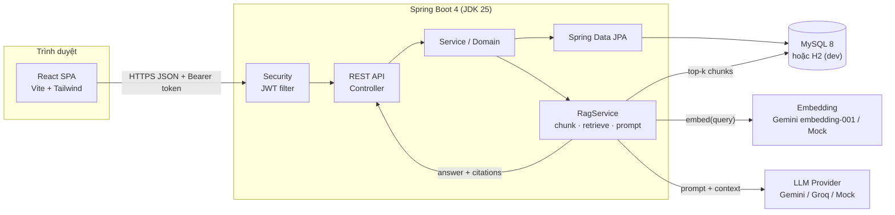
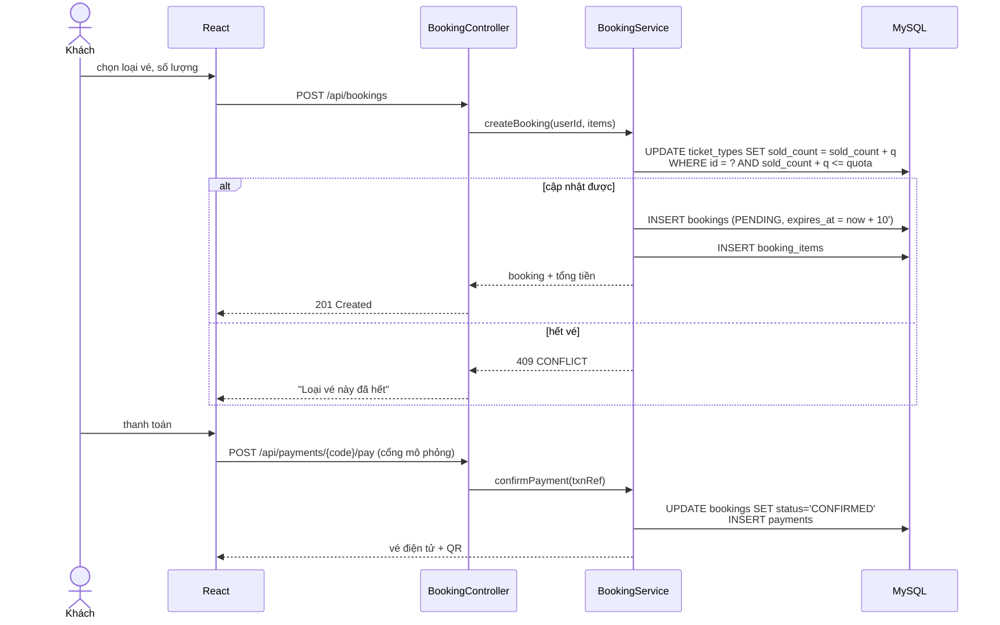
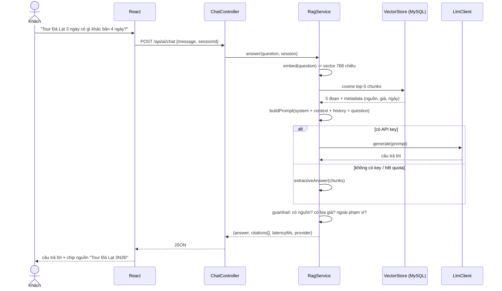

# 02 — Kiến trúc hệ thống

> ⚠️ **Bản cũ (monolith).** Kiến trúc đang chạy bằng Docker của dự án nằm ở
> [`09-kien-truc-microservices.md`](09-kien-truc-microservices.md). Tài liệu này giữ lại để tham khảo lịch sử.

> Mục tiêu: cả nhóm hình dung được **hệ thống gồm những khối nào, nói chuyện với nhau ra sao**, và biết chính xác mỗi người code ở đâu.

---

## 1. Sơ đồ tổng thể



**Nguyên tắc:** SPA không bao giờ gọi thẳng LLM; mọi lời gọi AI đi qua backend để (a) giấu API key, (b) ghi log/đo lường, (c) kiểm soát chi phí & nội dung.

## 2. Stack và lý do chọn

| Lớp | Công nghệ | Phiên bản | Vì sao |
|---|---|---|---|
| Ngôn ngữ | Java | 25 (đã cài) | Có sẵn trên máy, LTS |
| Backend | Spring Boot | 4.2.0 | Bản mới nhất, hỗ trợ JDK 25; hệ sinh thái mạnh, dễ giải thích với giảng viên |
| Web | Spring MVC + Validation | — | REST API, Bean Validation |
| Bảo mật | Spring Security + JJWT | Security 7 / jjwt 0.13 | JWT stateless, phân quyền theo role |
| ORM | Hibernate / JPA | — | Sinh schema dev nhanh; hiểu rõ entity |
| CSDL | MySQL 8 | 8.4 | Phổ biến trong đồ án; Docker hoá; H2 fallback khi không có Docker |
| API docs | springdoc-openapi | 3.2.1 | Swagger UI để cả nhóm & giảng viên thử API |
| Frontend | React + Vite | React 19 / Vite 8 | Dựng nhanh, HMR tốt; TypeScript để ít lỗi |
| Styling | Tailwind CSS | 4.x | Không phải viết CSS thuần, làm đẹp nhanh |
| Data fetching | TanStack Query + axios | 5.x / 1.x | Cache, loading/error state chuẩn |
| AI | Gemini free tier (chat + embedding) hoặc Groq (chat) | — | Miễn phí, đủ cho demo; có mock để offline |
| QR | ZXing | — | Sinh ảnh QR vé điện tử |
| Deploy | Docker Compose (tuỳ chọn) | — | Một lệnh chạy cả hệ thống |

> **Không dùng Lombok trong bộ khung** để tránh rủi ro annotation processor với JDK 25. Nếu cả nhóm muốn dùng, thêm dependency và kiểm tra build ngay — đừng để đến tuần 3 mới phát hiện lỗi.

## 3. Cấu trúc mã nguồn

```
He-thong-TMDT-ve-su-kien/
├── backend/                      # Spring Boot
│   └── src/main/java/vn/edu/tmdt/
│       ├── TmdtApplication.java
│       ├── auth/                 # User, Role, JWT, đăng nhập/đăng ký
│       ├── catalog/              # Event, TicketType, Tour, TourSchedule, tìm kiếm
│       ├── booking/              # Booking, BookingItem, Payment, Voucher
│       ├── ai/                   # LlmClient, EmbeddingClient, RagService, chống ảo giác
│       ├── organizer/            # API cho nhà tổ chức (dashboard, CRUD)
│       ├── admin/                # API quản trị
│       ├── web/                  # HealthController, ...
│       └── common/               # ApiResponse, exception, PageResponse
├── frontend/                     # React + Vite + TS
│   └── src/
│       ├── api/                  # axios client, hàm gọi endpoint
│       ├── features/             # auth, catalog, booking, ai, organizer, admin
│       ├── components/           # layout, ui dùng chung
│       ├── pages/                 # route-level
│       └── lib/                   # format tiền/ngày, storage
├── docs/                         # tài liệu dự án (bộ này)
├── docker-compose.yml            # MySQL + Adminer (tuỳ chọn)
└── README.md
```

**Quy ước package:** mỗi package = 1 bounded context nhỏ, gồm `Entity`, `Repository`, `Service`, `Controller`, `dto/`. Không gọi chéo repository giữa các package — chỉ gọi qua service.

## 4. Luồng nghiệp vụ chính

### 4.1 Đặt vé (có giữ chỗ + chống oversell)



**Điểm kỹ thuật đáng trình bày:**
- Giữ chỗ bằng `expires_at`; job quét mỗi phút để **nhả vé** của đơn hết hạn (trả lại `sold_count`).
- Chống oversell bằng **một câu UPDATE có điều kiện** (atomic), không dùng `SELECT ... rồi if`. Đây là câu trả lời cho câu hỏi phản biện kinh điển.
- Toàn bộ trong `@Transactional`; nếu bước sau lỗi thì rollback.

### 4.2 Chat RAG



Chi tiết từng bước, prompt mẫu và code: xem `08-rag-playbook.md`.

### 4.3 Gợi ý cá nhân hoá

1. Người dùng chọn sở thích khi đăng ký (biển đảo, núi, văn hoá, ẩm thực...) → lưu `users.interests`.
2. Backend embed chuỗi sở thích + lịch sử xem gần đây (7 ngày) thành 1 vector "hồ sơ".
3. Tính cosine với `knowledge_chunks` / vector tour.
4. Lọc theo luật: còn chỗ, ngày khởi hành ≥ hôm nay, giá ≤ ngân sách (nếu có).
5. Trộn điểm: `0.7 * similarity + 0.2 * popularity + 0.1 * recency`, trả top 6.

> Đây là **hybrid recommendation**: vector + luật. Rất dễ giải thích và vẫn "AI" đúng nghĩa, không cần train model.

## 5. Thiết kế lớp AI (quan trọng nhất về kiến trúc)

```java
public interface LlmClient {
    String provider();                       // "gemini" | "groq" | "mock"
    String generate(String systemPrompt, String userPrompt, double temperature);
}

public interface EmbeddingClient {
    String provider();
    int dimension();                         // 768 với gemini-embedding-001
    float[] embed(String text);
    List<float[]> embedBatch(List<String> texts);
}

public interface VectorStore {
    void upsert(String sourceType, Long sourceId, List<Chunk> chunks);
    List<RetrievedChunk> search(float[] queryVector, int topK, ChunkFilter filter);
    void deleteBySource(String sourceType, Long sourceId);
}
```

Ba lợi ích khi bảo vệ:
1. **Đổi nhà cung cấp 1 dòng config** (`ai.provider=groq`), không sửa nghiệp vụ.
2. **Mock provider** cho phép chạy offline, test tự động không tốn quota, demo không sợ mạng.
3. **VectorStore là interface** → hiện tại `MySqlVectorStore` (đọc bảng `knowledge_chunks`, cosine trong Java), tương lai thay `QdrantVectorStore` mà không đổi RagService.

### 5.1 Chọn nhà cung cấp AI

| Tiêu chí | Gemini (Google AI Studio) | Groq |
|---|---|---|
| Free tier | Có, giới hạn RPM/ngày | Có, RPM cao hơn |
| Chat tiếng Việt | Tốt | Tốt |
| Embedding | Có (`gemini-embedding-001`) | Không |
| Độ trễ | Trung bình | Rất thấp (LPU) |
| Phù hợp | **Toàn bộ RAG** (embed + chat) | Chat nhanh khi demo |

**Khuyến nghị:** dùng **Gemini cho embedding** (bắt buộc), **Groq hoặc Gemini cho chat** (cấu hình được). Dự phòng thứ 3: `mock`.

### 5.2 Giới hạn free tier phải thiết kế ngay từ đầu

- **Rate limit** (thường 5–15 request/phút) → hàng đợi + cache + debounce ở FE (không gửi mỗi lần gõ phím).
- **Timeout** 20 giây; retry 1 lần với backoff; nếu vẫn lỗi → trả lời extractive từ chunks.
- **Cache embedding** theo `content_hash` để không embed lại dữ liệu không đổi.
- **Giới hạn độ dài**: prompt ≤ ~6000 tokens, context 5 chunks × ~400 tokens.
- **Đo lường**: log `provider`, `latency_ms`, `token_in/out`, `fallback=true/false` vào `chat_messages`.

## 6. Bảo mật

| Rủi ro | Cách xử lý |
|---|---|
| Lộ mật khẩu | BCrypt (Spring Security) |
| Lộ JWT | Token 24h, không lưu localStorage nếu làm được (khuyến nghị: memory + refresh sau); tối thiểu là chấp nhận được cho đồ án, ghi rõ hạn chế |
| Leo thang quyền | Kiểm tra role ở **service** (không chỉ ở controller); organizer chỉ sửa tài nguyên của mình |
| Lộ API key AI | Key nằm ở biến môi trường backend, **không bao giờ** trong code FE/repo |
| Prompt injection | System prompt cố định + cấm context chứa chỉ thị; lọc đầu ra; giới hạn chủ đề |
| Spam/abuse | Rate limit ở `/api/ai/chat` và `/api/auth/login` (Bucket4j hoặc đếm trong bộ nhớ) |

## 7. Môi trường & cấu hình

| Môi trường | CSDL | AI | Ghi chú |
|---|---|---|---|
| `dev` (mặc định) | H2 file `./data/devdb` | mock nếu không có key | Chạy `mvn spring-boot:run` là xong, không cần Docker |
| `mysql` | MySQL 8 trong Docker | Gemini/Groq thật | `docker compose up -d` rồi `SPRING_PROFILES_ACTIVE=mysql` |
| `test` | H2 in-memory | mock | `mvn test`, không gọi mạng |

Biến môi trường quan trọng:

```env
JWT_SECRET=...                    # >= 32 ký tự
AI_PROVIDER=mock|gemini|groq      # mặc định mock
GEMINI_API_KEY=...
GROQ_API_KEY=...
DB_URL=jdbc:mysql://localhost:3306/tmdt...
```

## 8. Những quyết định kiến trúc và lý do (dùng cho báo cáo)

| Quyết định | Thay vì | Lý do |
|---|---|---|
| Monolith Spring Boot | Microservices | 3 người / 4 tuần; microservices là bẫy |
| JWT stateless | Session | Phù hợp SPA, dễ mở rộng, ít cấu hình |
| Vector store trong MySQL | Qdrant/pgvector | Giảm 1 service phải vận hành; 500–2000 chunk vẫn nhanh (< 50ms); đổi được nhờ interface |
| RAG tự viết ~250 dòng | Spring AI | Kiểm soát prompt, dễ giải thích, không bị version churn; vẫn có thể nêu Spring AI là hướng mở rộng |
| Cổng thanh toán mô phỏng | VNPay sandbox | Không cần tài khoản doanh nghiệp; luồng callback vẫn mô phỏng đủ |
| H2 cho dev | Bắt buộc MySQL | Docker Desktop hay tắt; giảm rủi ro "không chạy được máy bạn kia" |
| TanStack Query | useEffect + axios | Chuẩn hoá loading/error/cache, ít bug hơn |
