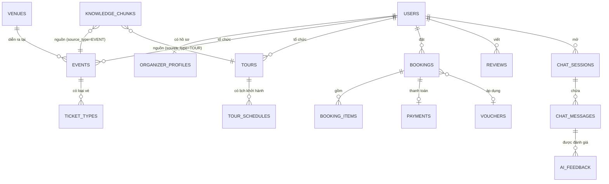

# 03 — Thiết kế cơ sở dữ liệu

> CSDL mục tiêu: **MySQL 8.4**, charset `utf8mb4`, engine InnoDB.
> Khi dev không có Docker, JPA tự sinh schema trên H2 theo cùng mô hình entity.
> **File DDL chuẩn để import:** `database/schema.sql` (được docker-compose mount tự động).

---

## 1. ERD



**Ghi chú thiết kế quan trọng:**

- **Một bảng `bookings` cho cả vé và tour** vì luồng thanh toán, huỷ, hoàn tiền giống nhau. Phân biệt bằng `booking_type` + `booking_items.item_type`.
- **`booking_items` lưu snapshot** (`item_name`, `unit_price`, `snapshot` JSON): giá đổi sau này không làm sai đơn cũ.
- **`knowledge_chunks` là "nguồn sự thật" của RAG**, tách khỏi bảng nghiệp vụ để có thể re-index, version, và không làm chậm truy vấn bán hàng.
- **`payments.txn_ref` unique** để callback lặp lại không tạo giao dịch trùng (idempotency).

## 2. DDL

```sql
CREATE DATABASE IF NOT EXISTS tmdt
  CHARACTER SET utf8mb4 COLLATE utf8mb4_0900_ai_ci;
USE tmdt;

-- =========================================================
-- 1. NGƯỜI DÙNG
-- =========================================================
CREATE TABLE users (
  id            BIGINT       NOT NULL AUTO_INCREMENT,
  email         VARCHAR(190) NOT NULL,
  password      VARCHAR(100) NOT NULL COMMENT 'BCrypt hash',
  full_name     VARCHAR(120) NOT NULL,
  phone         VARCHAR(20)  NULL,
  role          VARCHAR(20)  NOT NULL DEFAULT 'CUSTOMER' COMMENT 'CUSTOMER | ORGANIZER | ADMIN',
  interests     VARCHAR(255) NULL COMMENT 'csv: beach,mountain,culture,food',
  interests     VARCHAR(255) NULL COMMENT 'csv: beach,mountain,culture,food',
  enabled       TINYINT(1)   NOT NULL DEFAULT 1,
  created_at    DATETIME(6)  NOT NULL DEFAULT CURRENT_TIMESTAMP(6),
  PRIMARY KEY (id),
  UNIQUE KEY uk_users_email (email),
  KEY idx_users_role (role)
) ENGINE=InnoDB;

CREATE TABLE organizer_profiles (
  user_id       BIGINT       NOT NULL,
  company_name  VARCHAR(160) NOT NULL,
  tax_code      VARCHAR(30)  NULL,
  description   TEXT         NULL,
  logo_url      VARCHAR(500) NULL,
  verified      TINYINT(1)   NOT NULL DEFAULT 0,
  PRIMARY KEY (user_id),
  CONSTRAINT fk_org_user FOREIGN KEY (user_id) REFERENCES users (id) ON DELETE CASCADE
) ENGINE=InnoDB;

-- =========================================================
-- 2. ĐỊA ĐIỂM & SỰ KIỆN
-- =========================================================
CREATE TABLE venues (
  id        BIGINT       NOT NULL AUTO_INCREMENT,
  name      VARCHAR(160) NOT NULL,
  address   VARCHAR(255) NOT NULL,
  city      VARCHAR(80)  NOT NULL,
  capacity  INT          NULL,
  map_url   VARCHAR(500) NULL,
  PRIMARY KEY (id),
  KEY idx_venues_city (city)
) ENGINE=InnoDB;

CREATE TABLE events (
  id               BIGINT       NOT NULL AUTO_INCREMENT,
  organizer_id     BIGINT       NOT NULL,
  venue_id         BIGINT       NULL,
  title            VARCHAR(200) NOT NULL,
  slug             VARCHAR(220) NOT NULL,
  description      LONGTEXT     NULL,
  category         VARCHAR(40)  NOT NULL COMMENT 'music, theater, sport, workshop...',
  cover_image_url  VARCHAR(500) NULL,
  start_at         DATETIME(6)  NOT NULL,
  end_at           DATETIME(6)  NOT NULL,
  sale_start_at    DATETIME(6)  NULL,
  sale_end_at      DATETIME(6)  NULL,
  status           VARCHAR(20)  NOT NULL DEFAULT 'DRAFT' COMMENT 'DRAFT|PENDING|PUBLISHED|REJECTED|CANCELLED|FINISHED',
  created_at       DATETIME(6)  NOT NULL DEFAULT CURRENT_TIMESTAMP(6),
  updated_at       DATETIME(6)  NOT NULL DEFAULT CURRENT_TIMESTAMP(6) ON UPDATE CURRENT_TIMESTAMP(6),
  PRIMARY KEY (id),
  UNIQUE KEY uk_events_slug (slug),
  KEY idx_events_status_start (status, start_at),
  KEY idx_events_organizer (organizer_id),
  CONSTRAINT fk_events_org   FOREIGN KEY (organizer_id) REFERENCES users (id),
  CONSTRAINT fk_events_venue FOREIGN KEY (venue_id)     REFERENCES venues (id)
) ENGINE=InnoDB;

CREATE TABLE ticket_types (
  id            BIGINT        NOT NULL AUTO_INCREMENT,
  event_id      BIGINT        NOT NULL,
  name          VARCHAR(120)  NOT NULL COMMENT 'VIP, Standard, Early Bird...',
  description   VARCHAR(500)  NULL,
  price         DECIMAL(12,2) NOT NULL,
  currency      CHAR(3)       NOT NULL DEFAULT 'VND',
  quota         INT           NOT NULL,
  sold_count    INT           NOT NULL DEFAULT 0,
  max_per_order INT           NOT NULL DEFAULT 5,
  sale_start_at DATETIME(6)   NULL,
  sale_end_at   DATETIME(6)   NULL,
  version       BIGINT        NOT NULL DEFAULT 0 COMMENT 'optimistic lock',
  PRIMARY KEY (id),
  KEY idx_ticket_types_event (event_id),
  CONSTRAINT fk_ticket_event FOREIGN KEY (event_id) REFERENCES events (id) ON DELETE CASCADE,
  CONSTRAINT ck_ticket_quota CHECK (sold_count >= 0 AND sold_count <= quota)
) ENGINE=InnoDB;

-- =========================================================
-- 3. TOUR
-- =========================================================
CREATE TABLE tours (
  id             BIGINT        NOT NULL AUTO_INCREMENT,
  organizer_id   BIGINT        NOT NULL,
  title          VARCHAR(200)  NOT NULL,
  slug           VARCHAR(220)  NOT NULL,
  description    LONGTEXT      NULL,
  destination    VARCHAR(120)  NOT NULL,
  departure_city VARCHAR(80)   NOT NULL,
  duration_days  INT           NOT NULL,
  duration_nights INT          NOT NULL DEFAULT 0,
  base_price     DECIMAL(12,2) NOT NULL,
  cover_image_url VARCHAR(500) NULL,
  highlights     JSON          NULL COMMENT 'mảng chuỗi điểm nổi bật',
  included       JSON          NULL,
  excluded       JSON          NULL,
  status         VARCHAR(20)   NOT NULL DEFAULT 'DRAFT',
  created_at     DATETIME(6)   NOT NULL DEFAULT CURRENT_TIMESTAMP(6),
  updated_at     DATETIME(6)   NOT NULL DEFAULT CURRENT_TIMESTAMP(6) ON UPDATE CURRENT_TIMESTAMP(6),
  PRIMARY KEY (id),
  UNIQUE KEY uk_tours_slug (slug),
  KEY idx_tours_status (status),
  KEY idx_tours_destination (destination),
  CONSTRAINT fk_tours_org FOREIGN KEY (organizer_id) REFERENCES users (id)
) ENGINE=InnoDB;

CREATE TABLE tour_schedules (
  id             BIGINT        NOT NULL AUTO_INCREMENT,
  tour_id        BIGINT        NOT NULL,
  departure_date DATE          NOT NULL,
  return_date    DATE          NOT NULL,
  price          DECIMAL(12,2) NOT NULL,
  seats_total    INT           NOT NULL,
  seats_booked   INT           NOT NULL DEFAULT 0,
  status         VARCHAR(20)   NOT NULL DEFAULT 'OPEN' COMMENT 'OPEN|FULL|CLOSED|CANCELLED',
  version        BIGINT        NOT NULL DEFAULT 0,
  PRIMARY KEY (id),
  UNIQUE KEY uk_schedule (tour_id, departure_date),
  CONSTRAINT fk_schedule_tour FOREIGN KEY (tour_id) REFERENCES tours (id) ON DELETE CASCADE,
  CONSTRAINT ck_schedule_seats CHECK (seats_booked >= 0 AND seats_booked <= seats_total)
) ENGINE=InnoDB;

-- =========================================================
-- 4. ĐƠN HÀNG & THANH TOÁN
-- =========================================================
CREATE TABLE vouchers (
  id                 BIGINT        NOT NULL AUTO_INCREMENT,
  code               VARCHAR(40)   NOT NULL,
  name               VARCHAR(120)  NOT NULL,
  discount_type      VARCHAR(10)   NOT NULL COMMENT 'PERCENT|FIXED',
  discount_value     DECIMAL(12,2) NOT NULL,
  min_order_amount   DECIMAL(12,2) NOT NULL DEFAULT 0,
  max_discount_amount DECIMAL(12,2) NULL,
  usage_limit        INT           NULL,
  used_count         INT           NOT NULL DEFAULT 0,
  valid_from         DATETIME(6)   NULL,
  valid_to           DATETIME(6)   NULL,
  active             TINYINT(1)    NOT NULL DEFAULT 1,
  PRIMARY KEY (id),
  UNIQUE KEY uk_vouchers_code (code)
) ENGINE=InnoDB;

CREATE TABLE bookings (
  id              BIGINT        NOT NULL AUTO_INCREMENT,
  code            VARCHAR(20)   NOT NULL COMMENT 'mã đơn hiển thị, ví dụ TKT7X9K2M',
  user_id         BIGINT        NOT NULL,
  booking_type    VARCHAR(10)   NOT NULL COMMENT 'EVENT|TOUR',
  status          VARCHAR(20)   NOT NULL DEFAULT 'PENDING'
                  COMMENT 'PENDING|CONFIRMED|CANCELLED|EXPIRED|REFUNDED',
  subtotal        DECIMAL(12,2) NOT NULL DEFAULT 0,
  discount_amount DECIMAL(12,2) NOT NULL DEFAULT 0,
  total_amount    DECIMAL(12,2) NOT NULL DEFAULT 0,
  currency        CHAR(3)       NOT NULL DEFAULT 'VND',
  voucher_id      BIGINT        NULL,
  contact_name    VARCHAR(120)  NOT NULL,
  contact_email   VARCHAR(190)  NOT NULL,
  contact_phone   VARCHAR(20)   NULL,
  note            VARCHAR(500)  NULL,
  expires_at      DATETIME(6)   NULL COMMENT 'hạn giữ chỗ',
  confirmed_at    DATETIME(6)   NULL,
  cancelled_at    DATETIME(6)   NULL,
  created_at      DATETIME(6)   NOT NULL DEFAULT CURRENT_TIMESTAMP(6),
  updated_at      DATETIME(6)   NOT NULL DEFAULT CURRENT_TIMESTAMP(6) ON UPDATE CURRENT_TIMESTAMP(6),
  PRIMARY KEY (id),
  UNIQUE KEY uk_bookings_code (code),
  KEY idx_bookings_user (user_id, created_at DESC),
  KEY idx_bookings_status_expires (status, expires_at),
  CONSTRAINT fk_bookings_user    FOREIGN KEY (user_id)    REFERENCES users (id),
  CONSTRAINT fk_bookings_voucher FOREIGN KEY (voucher_id) REFERENCES vouchers (id)
) ENGINE=InnoDB;

CREATE TABLE booking_items (
  id            BIGINT        NOT NULL AUTO_INCREMENT,
  booking_id    BIGINT        NOT NULL,
  item_type     VARCHAR(10)   NOT NULL COMMENT 'TICKET|TOUR',
  ref_id        BIGINT        NOT NULL COMMENT 'ticket_types.id hoặc tour_schedules.id',
  item_name     VARCHAR(200)  NOT NULL COMMENT 'snapshot tên tại thời điểm mua',
  quantity      INT           NOT NULL,
  unit_price    DECIMAL(12,2) NOT NULL,
  amount        DECIMAL(12,2) NOT NULL,
  snapshot      JSON          NULL COMMENT 'thông tin hiển thị trên vé: giờ, địa điểm, lịch trình',
  checked_in_at DATETIME(6)   NULL,
  PRIMARY KEY (id),
  KEY idx_items_booking (booking_id),
  KEY idx_items_ref (item_type, ref_id),
  CONSTRAINT fk_items_booking FOREIGN KEY (booking_id) REFERENCES bookings (id) ON DELETE CASCADE,
  CONSTRAINT ck_items_qty CHECK (quantity > 0)
) ENGINE=InnoDB;

CREATE TABLE payments (
  id          BIGINT        NOT NULL AUTO_INCREMENT,
  booking_id  BIGINT        NOT NULL,
  provider    VARCHAR(30)   NOT NULL COMMENT 'MOCK|VNPAY|MOMO',
  txn_ref     VARCHAR(100)  NOT NULL COMMENT 'mã giao dịch phía cổng thanh toán',
  amount      DECIMAL(12,2) NOT NULL,
  status      VARCHAR(20)   NOT NULL COMMENT 'INIT|SUCCESS|FAILED|REFUNDED',
  paid_at     DATETIME(6)   NULL,
  raw_payload JSON          NULL,
  created_at  DATETIME(6)   NOT NULL DEFAULT CURRENT_TIMESTAMP(6),
  PRIMARY KEY (id),
  UNIQUE KEY uk_payment_txn (provider, txn_ref),
  KEY idx_payments_booking (booking_id),
  CONSTRAINT fk_payments_booking FOREIGN KEY (booking_id) REFERENCES bookings (id)
) ENGINE=InnoDB;

CREATE TABLE reviews (
  id          BIGINT      NOT NULL AUTO_INCREMENT,
  user_id     BIGINT      NOT NULL,
  target_type VARCHAR(10) NOT NULL COMMENT 'EVENT|TOUR',
  target_id   BIGINT      NOT NULL,
  rating      TINYINT     NOT NULL COMMENT '1..5',
  comment     TEXT        NULL,
  created_at  DATETIME(6) NOT NULL DEFAULT CURRENT_TIMESTAMP(6),
  PRIMARY KEY (id),
  UNIQUE KEY uk_review_once (user_id, target_type, target_id),
  KEY idx_reviews_target (target_type, target_id),
  CONSTRAINT fk_reviews_user FOREIGN KEY (user_id) REFERENCES users (id),
  CONSTRAINT ck_review_rating CHECK (rating BETWEEN 1 AND 5)
) ENGINE=InnoDB;

-- =========================================================
-- 5. RAG & HỘI THOẠI AI
-- =========================================================
CREATE TABLE knowledge_chunks (
  id              BIGINT       NOT NULL AUTO_INCREMENT,
  source_type     VARCHAR(20)  NOT NULL COMMENT 'EVENT|TOUR|FAQ|POLICY',
  source_id       BIGINT       NULL COMMENT 'NULL với FAQ/POLICY',
  title           VARCHAR(200) NOT NULL COMMENT 'tiêu đề hiển thị trong citation',
  chunk_index     INT          NOT NULL,
  content         TEXT         NOT NULL,
  content_hash    CHAR(64)     NOT NULL COMMENT 'sha256 để phát hiện cần re-embed',
  embedding       LONGTEXT     NOT NULL COMMENT 'mảng float JSON, ví dụ [0.12,-0.03,...]',
  embedding_model VARCHAR(60)  NOT NULL DEFAULT 'gemini-embedding-001',
  embedding_dim   INT          NOT NULL DEFAULT 768,
  updated_at      DATETIME(6)  NOT NULL DEFAULT CURRENT_TIMESTAMP(6) ON UPDATE CURRENT_TIMESTAMP(6),
  PRIMARY KEY (id),
  UNIQUE KEY uk_chunk (source_type, source_id, chunk_index),
  KEY idx_chunks_source (source_type, source_id)
) ENGINE=InnoDB;

CREATE TABLE chat_sessions (
  id              BIGINT      NOT NULL AUTO_INCREMENT,
  user_id         BIGINT      NULL,
  guest_key       VARCHAR(64) NULL COMMENT 'khách chưa đăng nhập',
  started_at      DATETIME(6) NOT NULL DEFAULT CURRENT_TIMESTAMP(6),
  last_message_at DATETIME(6) NULL,
  PRIMARY KEY (id),
  KEY idx_sessions_user (user_id, started_at DESC)
) ENGINE=InnoDB;

CREATE TABLE chat_messages (
  id         BIGINT      NOT NULL AUTO_INCREMENT,
  session_id BIGINT      NOT NULL,
  role       VARCHAR(12) NOT NULL COMMENT 'USER|ASSISTANT|SYSTEM',
  content    MEDIUMTEXT  NOT NULL,
  citations  JSON        NULL COMMENT '[{sourceType, sourceId, title, score}]',
  provider   VARCHAR(20) NULL COMMENT 'gemini|groq|mock',
  latency_ms INT         NULL,
  token_in   INT         NULL,
  token_out  INT         NULL,
  fallback   TINYINT(1)  NOT NULL DEFAULT 0 COMMENT '1 = dung tra loi extractive',
  refused    TINYINT(1)  NOT NULL DEFAULT 0 COMMENT '1 = tu choi ngoai pham vi',
  created_at DATETIME(6) NOT NULL DEFAULT CURRENT_TIMESTAMP(6),
  PRIMARY KEY (id),
  KEY idx_messages_session (session_id, created_at),
  CONSTRAINT fk_messages_session FOREIGN KEY (session_id) REFERENCES chat_sessions (id) ON DELETE CASCADE
) ENGINE=InnoDB;

CREATE TABLE ai_feedback (
  id         BIGINT      NOT NULL AUTO_INCREMENT,
  message_id BIGINT      NOT NULL,
  user_id    BIGINT      NULL,
  rating     TINYINT     NOT NULL COMMENT '1 = hữu ích, -1 = không hữu ích',
  comment    VARCHAR(500) NULL,
  created_at DATETIME(6) NOT NULL DEFAULT CURRENT_TIMESTAMP(6),
  PRIMARY KEY (id),
  KEY idx_feedback_message (message_id),
  CONSTRAINT fk_feedback_message FOREIGN KEY (message_id) REFERENCES chat_messages (id) ON DELETE CASCADE
) ENGINE=InnoDB;
```

## 3. Dữ liệu mẫu tối thiểu (để demo)

| Bảng | Số lượng | Ghi chú |
|---|---|---|
| users | 3 | admin / organizer / customer (seeder đã có sẵn ở bộ khung) |
| venues | 3 | Nhà hát lớn Hà Nội, SECC TP.HCM, Sân vận động Hàng Đẫy |
| events | 4 | 1 concert, 1 kịch, 1 workshop, 1 thể thao — có ảnh, mô tả dài ≥ 300 từ |
| ticket_types | 8 | 2 loại/event (VIP, Standard) |
| tours | 5 | Đà Lạt 3N2Đ, Đà Lạt 4N3Đ, Phú Quốc 4N3Đ, Hà Giang 3N2Đ, Hội An 2N1Đ |
| tour_schedules | 8 | Mỗi tour 1–2 lịch, ngày trong tương lai |
| vouchers | 3 | `WELCOME10` (10%), `TOUR500` (giảm 500k), `HETHONG` (hết hạn — để demo lỗi) |
| knowledge_chunks | 80–150 | Sinh tự động từ events/tours/FAQ |
| reviews | 10 | Rating 4–5 để trang chi tiết sinh động |

> **Mẹo demo:** mô tả tour phải dài và có chi tiết *so sánh được* (lịch trình từng ngày, giá, bao gồm/không bao gồm). RAG chỉ hay khi dữ liệu đủ dày.

## 4. Quy ước dữ liệu

| Quy ước | Giá trị |
|---|---|
| Thời gian | Lưu **UTC** (`DATETIME(6)`), hiển thị theo `Asia/Ho_Chi_Minh` ở FE |
| Tiền | `DECIMAL(12,2)`, đơn vị VND (không phần thập phân khi hiển thị) |
| Mã đơn | 10 ký tự base32, sinh bằng `SecureRandom` (tránh đoán được) |
| Xoá mềm | Sự kiện/tour dùng `status`, không xoá cứng (giữ lịch sử đơn) |
| Slug | sinh từ tiêu đề + hậu tố ngẫu nhiên nếu trùng |
| Enum | lưu `VARCHAR` (không dùng `ENUM` của MySQL) để dễ tiến hoá |

## 5. Câu query "đắt" cần chú ý

```sql
-- 1. Trang chủ: sự kiện đang mở bán (dùng idx_events_status_start)
SELECT id, title, start_at FROM events
WHERE status = 'PUBLISHED' AND start_at >= NOW()
ORDER BY start_at LIMIT 12;

-- 2. Giữ chỗ an toàn (atomic, chống oversell)
UPDATE ticket_types
SET sold_count = sold_count + ?, version = version + 1
WHERE id = ? AND sold_count + ? <= quota;

-- 3. Nhả vé đơn hết hạn (job mỗi phút, dùng idx_bookings_status_expires)
SELECT id FROM bookings WHERE status = 'PENDING' AND expires_at < NOW() LIMIT 100;

-- 4. Thống kê doanh thu organizer
SELECT DATE(b.confirmed_at) d, SUM(b.total_amount) revenue, COUNT(*) orders
FROM bookings b
JOIN booking_items bi ON bi.booking_id = b.id
WHERE bi.item_type = 'TICKET' AND b.status = 'CONFIRMED'
  AND b.confirmed_at >= ?
GROUP BY d ORDER BY d;
```

## 6. Mapping JPA

- `@Enumerated(EnumType.STRING)` cho mọi enum.
- `@Version` trên `ticket_types` và `tour_schedules` (lớp bảo vệ thứ hai; lớp chính là câu UPDATE có điều kiện).
- `@Column(columnDefinition = "JSON")` + converter `List<String>` ↔ JSON cho `highlights`.
- `BigDecimal` cho tiền, **không bao giờ `double`**.
- `Instant` cho mốc thời gian; `LocalDate` cho ngày khởi hành.

> Bảng `knowledge_chunks.embedding` lưu JSON text (không dùng kiểu VECTOR của MySQL 9) để chạy được trên MySQL 8 và H2. Với 1000 chunk × 768 chiều, cosine trong Java mất ~5–10ms — hoàn toàn ổn cho đồ án.
